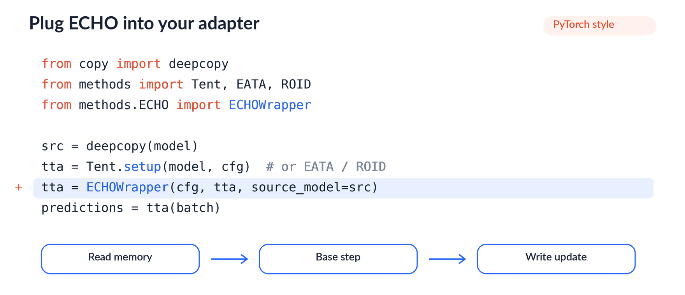

<div align="center">


### Static in Shift Space: Test-Time Adaptation that Remembers

<a href="https://pytorch.org/"></a>
<a href="https://www.python.org/"></a>
<a href="LICENSE"></a>

[Quick Start](#quick-start) · [Benchmarks](#benchmarks) · [Code Map](#code-map)

</div>

---

<p align="center">

</p>

## Quick Start

Install the dependencies and try the dataset-free CPU demo:

```bash
pip install -r requirements.txt
python examples/demo.py
```

Benchmark runs require a CUDA GPU. Set the data root and launch an experiment:

```bash
export ECHO_DATA_DIR=/path/to/datasets
bash scripts/run.sh Tent inc echo
```

The launcher supports **Tent**, **EATA**, and **ROID**. Replace `echo` with
`baseline` to run the base adapter. Results and diagnostics are saved in `outputs/`.
Configurations live in [configs/](configs/).

<details>
<summary><b>Dataset layout</b></summary>

```text
datasets/
├── ImageNet/
├── ImageNet-C/
├── ImageNet-3DCC/
├── ImageNet-C-Bar/
└── imagenet-d/
    ├── lists/  # clipart_list.txt, infograph_list.txt, painting_list.txt, sketch_list.txt
    ├── clipart/
    ├── infograph/
    ├── painting/
    └── sketch/
```

Corruption folders follow the orders in [configs/order/](configs/order/).
EATA also uses ImageNet training data for Fisher initialization. Supply D109 lists
in `imagenet-d/lists/`, with each line containing a relative image path and its
109-class label (`relative_image_path label`).
Model construction and preprocessing are defined in [core/model/](core/model/).

</details>

## Benchmarks

Choose a scenario with `bash scripts/run.sh <method> <scenario> <echo|baseline>`.

| Scenario | Stream |
| :--- | :--- |
| `inc` | ImageNet-C |
| `3dcc` | ImageNet-3DCC |
| `cbar` | ImageNet-C-Bar |
| `multi` | IN-C → 3DCC → C-Bar |
| `shuffle` | ImageNet-C with shuffled domain order |
| `imbalance` | ImageNet-C with temporal label imbalance |
| `d109` | ImageNet-D109 natural domain shifts |
| `source-error` | Source-misclassified ImageNet-C samples |

## Code Map

| Location | Contents |
| :--- | :--- |
| [methods/ECHO/](methods/ECHO/) | Associative memory and shift keys |
| [methods/](methods/) | Base adapter integrations |
| [scripts/run.sh](scripts/run.sh) | Unified experiment launcher |
| [tests/](tests/) | CPU checks of memory behavior and reset |

## Acknowledgements & License

Built on Tent, EATA, ROID, RobustBench, and Torchvision.
See [third-party acknowledgements](THIRD_PARTY_NOTICES.md) for attribution and
upstream licenses. ECHO is released under the [MIT license](LICENSE).
